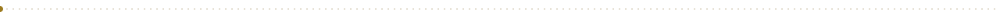
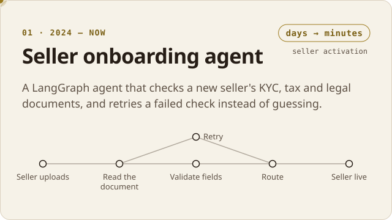
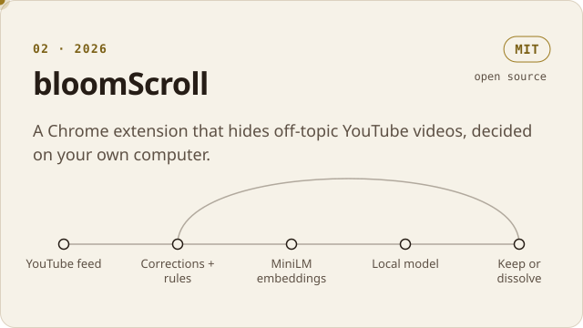
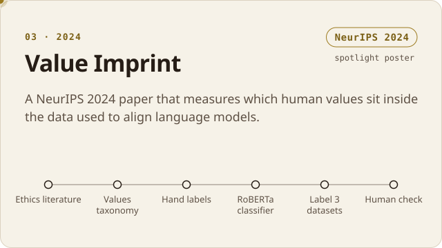
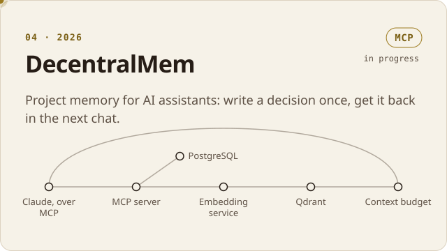
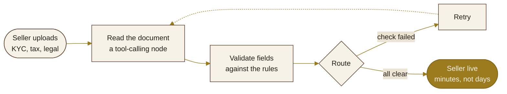
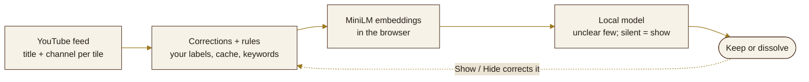
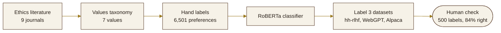
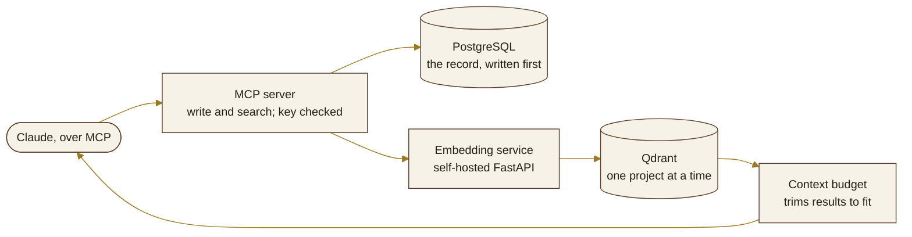

<!--
  Hello, source reader. Every image here is a hand-built SVG in my site's colours
  (Tobacco & Brass in light mode, Espresso Night in dark). build/build.py makes them.
-->

<a href="https://rohan2010.github.io">
  <picture>
    <source media="(prefers-color-scheme: dark)" srcset="assets/hero-dark.svg">
    
  </picture>
</a>

<p align="center">
  <a href="https://rohan2010.github.io"><b>Website</b></a> &nbsp;·&nbsp;
  <a href="https://rohan2010.github.io/notebook/">Notebook</a> &nbsp;·&nbsp;
  <a href="https://rohan2010.github.io/playground/">Playground</a> &nbsp;·&nbsp;
  <a href="https://www.linkedin.com/in/rohan-pant/">LinkedIn</a> &nbsp;·&nbsp;
  <a href="mailto:rohanpant.work@gmail.com">Email</a>
</p>

I'm Rohan. I build AI agents that do real work, and the evals and guardrails that stop them making things up. 3+ years of building things people use, an M.S. in Human-Computer Interaction from Purdue, and a NeurIPS 2024 paper.[^neurips] Open to full-stack and AI engineering roles.

<picture>
  <source media="(prefers-color-scheme: dark)" srcset="assets/divider-dark.svg">
  
</picture>

## Selected work

<p>
  <a href="https://rohan2010.github.io/work/onboarding-agent/"><picture><source media="(prefers-color-scheme: dark)" srcset="assets/work-onboarding-agent-dark.svg"></picture></a>
  <a href="https://rohan2010.github.io/work/bloomscroll/"><picture><source media="(prefers-color-scheme: dark)" srcset="assets/work-bloomscroll-dark.svg"></picture></a>
  <a href="https://rohan2010.github.io/work/value-imprint/"><picture><source media="(prefers-color-scheme: dark)" srcset="assets/work-value-imprint-dark.svg"></picture></a>
  <a href="https://rohan2010.github.io/work/decentralmem/"><picture><source media="(prefers-color-scheme: dark)" srcset="assets/work-decentralmem-dark.svg"></picture></a>
</p>

<sub>Each card opens its case study. Code: <a href="https://github.com/rohan2010/bloomScroll">bloomScroll</a> · <a href="https://github.com/rohan2010/decenz-mcp">DecentralMem</a> · <a href="https://arxiv.org/abs/2411.11937">Value Imprint paper</a>. The onboarding agent runs at my day job, so its code stays there.</sub>

### How the onboarding agent thinks

It doesn't guess. When a check fails, it goes back and reads again.



<details>
<summary><b>The other three, as diagrams</b></summary>
<br>

**bloomScroll.** Your corrections go back into the rules, so it learns what you came for.



**Value Imprint.** From ethics journals to an audit of three RLHF datasets.



**DecentralMem.** The record is written first; the vectors are only there to find it.



</details>

## How I got here

| | When | What |
|:--|:--|:--|
| `DEL` | 2018 – 2022 | B.Tech in Information Technology, Maharaja Agrasen Institute of Technology, Delhi |
| `DEL` | 2021 | SDE intern, Container Corporation of India: a handwriting model that runs offline, with a person checking the 15% it was least sure of |
| `DXB` | 2021 – 2022 | Software engineer, Let's Dunch (remote, Dubai): a "who to meet" recommender, and 30% more sign-ups after a redesign I led with a team of three |
| `LAF` | 2022 – 2024 | M.S. in Human-Computer Interaction, Purdue University |
| `YVR` | 2024 | Value Imprint published at NeurIPS 2024 |
| `NYC` | 2024 – now | Software engineer at my day job (remote, New York): AI agents, the guardrails that keep them honest, and the platform around them |

<details>
<summary><b>The same thing, on a map</b> <sub>(drag and zoom)</sub></summary>
<br>

<!-- MAP:START -->
```geojson
{
 "type": "FeatureCollection",
 "features": [
  {
   "type": "Feature",
   "geometry": {
    "type": "Point",
    "coordinates": [
     77.209,
     28.6139
    ]
   },
   "properties": {
    "name": "Delhi",
    "what": "Home. B.Tech in IT (2018 \u2013 2022); based here now.",
    "marker-color": "#9c7a1e",
    "marker-symbol": "star",
    "marker-size": "medium"
   }
  },
  {
   "type": "Feature",
   "geometry": {
    "type": "Point",
    "coordinates": [
     -86.9212,
     40.4237
    ]
   },
   "properties": {
    "name": "West Lafayette, Indiana",
    "what": "M.S. in Human-Computer Interaction, Purdue (2022 \u2013 2024).",
    "marker-color": "#9c7a1e",
    "marker-symbol": "star",
    "marker-size": "medium"
   }
  },
  {
   "type": "Feature",
   "geometry": {
    "type": "Point",
    "coordinates": [
     -87.6244,
     41.8827
    ]
   },
   "properties": {
    "name": "Chicago",
    "what": "The photo on the desk: Lake Michigan.",
    "marker-color": "#5a3d2b",
    "marker-symbol": "circle",
    "marker-size": "medium"
   }
  },
  {
   "type": "Feature",
   "geometry": {
    "type": "Point",
    "coordinates": [
     55.2708,
     25.2048
    ]
   },
   "properties": {
    "name": "Dubai",
    "what": "Let's Dunch, a remote software engineering job (2021 \u2013 2022).",
    "marker-color": "#5a3d2b",
    "marker-symbol": "circle",
    "marker-size": "medium"
   }
  },
  {
   "type": "Feature",
   "geometry": {
    "type": "Point",
    "coordinates": [
     -74.006,
     40.7128
    ]
   },
   "properties": {
    "name": "New York",
    "what": "My day job, remote (2024 \u2013 now).",
    "marker-color": "#5a3d2b",
    "marker-symbol": "circle",
    "marker-size": "medium"
   }
  },
  {
   "type": "Feature",
   "geometry": {
    "type": "Point",
    "coordinates": [
     -123.1207,
     49.2827
    ]
   },
   "properties": {
    "name": "Vancouver",
    "what": "Where NeurIPS 2024 was held; Value Imprint was a spotlight poster.",
    "marker-color": "#5a3d2b",
    "marker-symbol": "circle",
    "marker-size": "medium"
   }
  },
  {
   "type": "Feature",
   "geometry": {
    "type": "LineString",
    "coordinates": [
     [
      77.209,
      28.6139
     ],
     [
      -86.9212,
      40.4237
     ]
    ]
   },
   "properties": {
    "name": "Delhi \u2192 Purdue \u2192 Delhi",
    "stroke": "#9c7a1e",
    "stroke-width": 2
   }
  }
 ]
}
```
<!-- MAP:END -->

</details>

## What I type with

<table>
  <tr>
    <td><b>AI and LLM ops</b></td>
    <td><kbd>LangGraph</kbd> <kbd>MCP</kbd> <kbd>RAG</kbd> <kbd>embeddings</kbd> <kbd>evals</kbd> <kbd>guardrails</kbd> <kbd>LoRA / PEFT</kbd> <kbd>Claude</kbd> <kbd>GPT-4o</kbd> <kbd>Gemini</kbd></td>
  </tr>
  <tr>
    <td><b>Web</b></td>
    <td><kbd>React</kbd> <kbd>Next.js</kbd> <kbd>Tailwind</kbd> <kbd>Node.js</kbd> <kbd>FastAPI</kbd> <kbd>Spring Boot</kbd> <kbd>.NET</kbd></td>
  </tr>
  <tr>
    <td><b>Data and infra</b></td>
    <td><kbd>PostgreSQL</kbd> <kbd>MongoDB</kbd> <kbd>Qdrant</kbd> <kbd>Redis</kbd> <kbd>Docker</kbd> <kbd>GitHub Actions</kbd> <kbd>Azure DevOps</kbd></td>
  </tr>
  <tr>
    <td><b>Languages</b></td>
    <td><kbd>Python</kbd> <kbd>JavaScript</kbd> <kbd>Java</kbd> <kbd>C++</kbd> <kbd>C#</kbd> <kbd>SQL</kbd> <kbd>Dart</kbd> <kbd>Kotlin</kbd></td>
  </tr>
</table>

## From the Notebook

Writing on building with AI. This list updates itself from the [RSS feed](https://rohan2010.github.io/notebook/feed.xml).

<!-- BLOG-POST-LIST:START -->
- [LLMs Learned to Talk. Jev Wants AI to Decide.](https://rohan2010.github.io/notebook/jev-wants-ai-to-decide/) <sub>Oct 27, 2026</sub>
- [The Empathy Engine: Fine-Tuning Gemma 3 270M with LoRA for Mental Health Chatbots](https://rohan2010.github.io/notebook/fine-tuning-gemma-3-empathy/) <sub>Jan 22, 2026</sub>
<!-- BLOG-POST-LIST:END -->

## From the Playground

Landing-page pieces that run live, each with a prompt to build your own with a coding agent.

<details>
<summary><b>Six of them so far</b></summary>
<br>

| Piece | What it does |
|:--|:--|
| [Brass ring](https://rohan2010.github.io/playground/brass-ring/) | A 3D object hero in polished brass |
| [Decode headline](https://rohan2010.github.io/playground/decode-headline/) | A headline that decodes itself |
| [Dot grid](https://rohan2010.github.io/playground/dot-grid/) | A dot grid that warms under the cursor |
| [Dot terrain](https://rohan2010.github.io/playground/dot-terrain/) | A field of brass dots that ripples under the cursor |
| [Living paper](https://rohan2010.github.io/playground/living-paper/) | A shader background that moves like ink in water |
| [Spotlight cards](https://rohan2010.github.io/playground/spotlight-cards/) | A feature grid lit by the cursor |

</details>

## Now

- [x] A portfolio with an isometric desk you can take apart: [rohan2010.github.io](https://rohan2010.github.io)
- [x] bloomScroll's early release, open source under MIT
- [ ] DecentralMem: other LLM connectors, under test
- [ ] Hades. Currently losing.[^hades]

<details>
<summary><b>The desk, in 3D</b> <sub>(drag to turn it)</sub></summary>
<br>

<!-- DESK-STL:START -->
```stl
solid desk
facet normal 0 0 -1
outer loop
vertex 0 0 70
vertex 0 70 70
vertex 140 70 70
endloop
endfacet
facet normal 0 0 -1
outer loop
vertex 0 0 70
vertex 140 70 70
vertex 140 0 70
endloop
endfacet
facet normal 0 0 1
outer loop
vertex 0 0 74
vertex 140 0 74
vertex 140 70 74
endloop
endfacet
facet normal 0 0 1
outer loop
vertex 0 0 74
vertex 140 70 74
vertex 0 70 74
endloop
endfacet
facet normal 0 -1 0
outer loop
vertex 0 0 70
vertex 140 0 70
vertex 140 0 74
endloop
endfacet
facet normal 0 -1 0
outer loop
vertex 0 0 70
vertex 140 0 74
vertex 0 0 74
endloop
endfacet
facet normal 0 1 0
outer loop
vertex 0 70 70
vertex 0 70 74
vertex 140 70 74
endloop
endfacet
facet normal 0 1 0
outer loop
vertex 0 70 70
vertex 140 70 74
vertex 140 70 70
endloop
endfacet
facet normal -1 0 0
outer loop
vertex 0 0 70
vertex 0 0 74
vertex 0 70 74
endloop
endfacet
facet normal -1 0 0
outer loop
vertex 0 0 70
vertex 0 70 74
vertex 0 70 70
endloop
endfacet
facet normal 1 0 0
outer loop
vertex 140 0 70
vertex 140 70 70
vertex 140 70 74
endloop
endfacet
facet normal 1 0 0
outer loop
vertex 140 0 70
vertex 140 70 74
vertex 140 0 74
endloop
endfacet
facet normal 0 0 -1
outer loop
vertex 4 4 0
vertex 4 9 0
vertex 9 9 0
endloop
endfacet
facet normal 0 0 -1
outer loop
vertex 4 4 0
vertex 9 9 0
vertex 9 4 0
endloop
endfacet
facet normal 0 0 1
outer loop
vertex 4 4 70
vertex 9 4 70
vertex 9 9 70
endloop
endfacet
facet normal 0 0 1
outer loop
vertex 4 4 70
vertex 9 9 70
vertex 4 9 70
endloop
endfacet
facet normal 0 -1 0
outer loop
vertex 4 4 0
vertex 9 4 0
vertex 9 4 70
endloop
endfacet
facet normal 0 -1 0
outer loop
vertex 4 4 0
vertex 9 4 70
vertex 4 4 70
endloop
endfacet
facet normal 0 1 0
outer loop
vertex 4 9 0
vertex 4 9 70
vertex 9 9 70
endloop
endfacet
facet normal 0 1 0
outer loop
vertex 4 9 0
vertex 9 9 70
vertex 9 9 0
endloop
endfacet
facet normal -1 0 0
outer loop
vertex 4 4 0
vertex 4 4 70
vertex 4 9 70
endloop
endfacet
facet normal -1 0 0
outer loop
vertex 4 4 0
vertex 4 9 70
vertex 4 9 0
endloop
endfacet
facet normal 1 0 0
outer loop
vertex 9 4 0
vertex 9 9 0
vertex 9 9 70
endloop
endfacet
facet normal 1 0 0
outer loop
vertex 9 4 0
vertex 9 9 70
vertex 9 4 70
endloop
endfacet
facet normal 0 0 -1
outer loop
vertex 131 4 0
vertex 131 9 0
vertex 136 9 0
endloop
endfacet
facet normal 0 0 -1
outer loop
vertex 131 4 0
vertex 136 9 0
vertex 136 4 0
endloop
endfacet
facet normal 0 0 1
outer loop
vertex 131 4 70
vertex 136 4 70
vertex 136 9 70
endloop
endfacet
facet normal 0 0 1
outer loop
vertex 131 4 70
vertex 136 9 70
vertex 131 9 70
endloop
endfacet
facet normal 0 -1 0
outer loop
vertex 131 4 0
vertex 136 4 0
vertex 136 4 70
endloop
endfacet
facet normal 0 -1 0
outer loop
vertex 131 4 0
vertex 136 4 70
vertex 131 4 70
endloop
endfacet
facet normal 0 1 0
outer loop
vertex 131 9 0
vertex 131 9 70
vertex 136 9 70
endloop
endfacet
facet normal 0 1 0
outer loop
vertex 131 9 0
vertex 136 9 70
vertex 136 9 0
endloop
endfacet
facet normal -1 0 0
outer loop
vertex 131 4 0
vertex 131 4 70
vertex 131 9 70
endloop
endfacet
facet normal -1 0 0
outer loop
vertex 131 4 0
vertex 131 9 70
vertex 131 9 0
endloop
endfacet
facet normal 1 0 0
outer loop
vertex 136 4 0
vertex 136 9 0
vertex 136 9 70
endloop
endfacet
facet normal 1 0 0
outer loop
vertex 136 4 0
vertex 136 9 70
vertex 136 4 70
endloop
endfacet
facet normal 0 0 -1
outer loop
vertex 4 61 0
vertex 4 66 0
vertex 9 66 0
endloop
endfacet
facet normal 0 0 -1
outer loop
vertex 4 61 0
vertex 9 66 0
vertex 9 61 0
endloop
endfacet
facet normal 0 0 1
outer loop
vertex 4 61 70
vertex 9 61 70
vertex 9 66 70
endloop
endfacet
facet normal 0 0 1
outer loop
vertex 4 61 70
vertex 9 66 70
vertex 4 66 70
endloop
endfacet
facet normal 0 -1 0
outer loop
vertex 4 61 0
vertex 9 61 0
vertex 9 61 70
endloop
endfacet
facet normal 0 -1 0
outer loop
vertex 4 61 0
vertex 9 61 70
vertex 4 61 70
endloop
endfacet
facet normal 0 1 0
outer loop
vertex 4 66 0
vertex 4 66 70
vertex 9 66 70
endloop
endfacet
facet normal 0 1 0
outer loop
vertex 4 66 0
vertex 9 66 70
vertex 9 66 0
endloop
endfacet
facet normal -1 0 0
outer loop
vertex 4 61 0
vertex 4 61 70
vertex 4 66 70
endloop
endfacet
facet normal -1 0 0
outer loop
vertex 4 61 0
vertex 4 66 70
vertex 4 66 0
endloop
endfacet
facet normal 1 0 0
outer loop
vertex 9 61 0
vertex 9 66 0
vertex 9 66 70
endloop
endfacet
facet normal 1 0 0
outer loop
vertex 9 61 0
vertex 9 66 70
vertex 9 61 70
endloop
endfacet
facet normal 0 0 -1
outer loop
vertex 131 61 0
vertex 131 66 0
vertex 136 66 0
endloop
endfacet
facet normal 0 0 -1
outer loop
vertex 131 61 0
vertex 136 66 0
vertex 136 61 0
endloop
endfacet
facet normal 0 0 1
outer loop
vertex 131 61 70
vertex 136 61 70
vertex 136 66 70
endloop
endfacet
facet normal 0 0 1
outer loop
vertex 131 61 70
vertex 136 66 70
vertex 131 66 70
endloop
endfacet
facet normal 0 -1 0
outer loop
vertex 131 61 0
vertex 136 61 0
vertex 136 61 70
endloop
endfacet
facet normal 0 -1 0
outer loop
vertex 131 61 0
vertex 136 61 70
vertex 131 61 70
endloop
endfacet
facet normal 0 1 0
outer loop
vertex 131 66 0
vertex 131 66 70
vertex 136 66 70
endloop
endfacet
facet normal 0 1 0
outer loop
vertex 131 66 0
vertex 136 66 70
vertex 136 66 0
endloop
endfacet
facet normal -1 0 0
outer loop
vertex 131 61 0
vertex 131 61 70
vertex 131 66 70
endloop
endfacet
facet normal -1 0 0
outer loop
vertex 131 61 0
vertex 131 66 70
vertex 131 66 0
endloop
endfacet
facet normal 1 0 0
outer loop
vertex 136 61 0
vertex 136 66 0
vertex 136 66 70
endloop
endfacet
facet normal 1 0 0
outer loop
vertex 136 61 0
vertex 136 66 70
vertex 136 61 70
endloop
endfacet
facet normal 0 0 -1
outer loop
vertex 6 6 62
vertex 6 9 62
vertex 134 9 62
endloop
endfacet
facet normal 0 0 -1
outer loop
vertex 6 6 62
vertex 134 9 62
vertex 134 6 62
endloop
endfacet
facet normal 0 0 1
outer loop
vertex 6 6 70
vertex 134 6 70
vertex 134 9 70
endloop
endfacet
facet normal 0 0 1
outer loop
vertex 6 6 70
vertex 134 9 70
vertex 6 9 70
endloop
endfacet
facet normal 0 -1 0
outer loop
vertex 6 6 62
vertex 134 6 62
vertex 134 6 70
endloop
endfacet
facet normal 0 -1 0
outer loop
vertex 6 6 62
vertex 134 6 70
vertex 6 6 70
endloop
endfacet
facet normal 0 1 0
outer loop
vertex 6 9 62
vertex 6 9 70
vertex 134 9 70
endloop
endfacet
facet normal 0 1 0
outer loop
vertex 6 9 62
vertex 134 9 70
vertex 134 9 62
endloop
endfacet
facet normal -1 0 0
outer loop
vertex 6 6 62
vertex 6 6 70
vertex 6 9 70
endloop
endfacet
facet normal -1 0 0
outer loop
vertex 6 6 62
vertex 6 9 70
vertex 6 9 62
endloop
endfacet
facet normal 1 0 0
outer loop
vertex 134 6 62
vertex 134 9 62
vertex 134 9 70
endloop
endfacet
facet normal 1 0 0
outer loop
vertex 134 6 62
vertex 134 9 70
vertex 134 6 70
endloop
endfacet
facet normal 0 0 -1
outer loop
vertex 6 61 62
vertex 6 64 62
vertex 134 64 62
endloop
endfacet
facet normal 0 0 -1
outer loop
vertex 6 61 62
vertex 134 64 62
vertex 134 61 62
endloop
endfacet
facet normal 0 0 1
outer loop
vertex 6 61 70
vertex 134 61 70
vertex 134 64 70
endloop
endfacet
facet normal 0 0 1
outer loop
vertex 6 61 70
vertex 134 64 70
vertex 6 64 70
endloop
endfacet
facet normal 0 -1 0
outer loop
vertex 6 61 62
vertex 134 61 62
vertex 134 61 70
endloop
endfacet
facet normal 0 -1 0
outer loop
vertex 6 61 62
vertex 134 61 70
vertex 6 61 70
endloop
endfacet
facet normal 0 1 0
outer loop
vertex 6 64 62
vertex 6 64 70
vertex 134 64 70
endloop
endfacet
facet normal 0 1 0
outer loop
vertex 6 64 62
vertex 134 64 70
vertex 134 64 62
endloop
endfacet
facet normal -1 0 0
outer loop
vertex 6 61 62
vertex 6 61 70
vertex 6 64 70
endloop
endfacet
facet normal -1 0 0
outer loop
vertex 6 61 62
vertex 6 64 70
vertex 6 64 62
endloop
endfacet
facet normal 1 0 0
outer loop
vertex 134 61 62
vertex 134 64 62
vertex 134 64 70
endloop
endfacet
facet normal 1 0 0
outer loop
vertex 134 61 62
vertex 134 64 70
vertex 134 61 70
endloop
endfacet
facet normal 0 0 -1
outer loop
vertex 30 8 74
vertex 30 38 74
vertex 110 38 74
endloop
endfacet
facet normal 0 0 -1
outer loop
vertex 30 8 74
vertex 110 38 74
vertex 110 8 74
endloop
endfacet
facet normal 0 0 1
outer loop
vertex 30 8 74.6
vertex 110 8 74.6
vertex 110 38 74.6
endloop
endfacet
facet normal 0 0 1
outer loop
vertex 30 8 74.6
vertex 110 38 74.6
vertex 30 38 74.6
endloop
endfacet
facet normal 0 -1 0
outer loop
vertex 30 8 74
vertex 110 8 74
vertex 110 8 74.6
endloop
endfacet
facet normal 0 -1 0
outer loop
vertex 30 8 74
vertex 110 8 74.6
vertex 30 8 74.6
endloop
endfacet
facet normal 0 1 0
outer loop
vertex 30 38 74
vertex 30 38 74.6
vertex 110 38 74.6
endloop
endfacet
facet normal 0 1 0
outer loop
vertex 30 38 74
vertex 110 38 74.6
vertex 110 38 74
endloop
endfacet
facet normal -1 0 0
outer loop
vertex 30 8 74
vertex 30 8 74.6
vertex 30 38 74.6
endloop
endfacet
facet normal -1 0 0
outer loop
vertex 30 8 74
vertex 30 38 74.6
vertex 30 38 74
endloop
endfacet
facet normal 1 0 0
outer loop
vertex 110 8 74
vertex 110 38 74
vertex 110 38 74.6
endloop
endfacet
facet normal 1 0 0
outer loop
vertex 110 8 74
vertex 110 38 74.6
vertex 110 8 74.6
endloop
endfacet
facet normal 0 0 -1
outer loop
vertex 40 14 74.6
vertex 40 28 74.6
vertex 84 28 74.6
endloop
endfacet
facet normal 0 0 -1
outer loop
vertex 40 14 74.6
vertex 84 28 74.6
vertex 84 14 74.6
endloop
endfacet
facet normal 0 0 1
outer loop
vertex 40 14 77
vertex 84 14 77
vertex 84 28 77
endloop
endfacet
facet normal 0 0 1
outer loop
vertex 40 14 77
vertex 84 28 77
vertex 40 28 77
endloop
endfacet
facet normal 0 -1 0
outer loop
vertex 40 14 74.6
vertex 84 14 74.6
vertex 84 14 77
endloop
endfacet
facet normal 0 -1 0
outer loop
vertex 40 14 74.6
vertex 84 14 77
vertex 40 14 77
endloop
endfacet
facet normal 0 1 0
outer loop
vertex 40 28 74.6
vertex 40 28 77
vertex 84 28 77
endloop
endfacet
facet normal 0 1 0
outer loop
vertex 40 28 74.6
vertex 84 28 77
vertex 84 28 74.6
endloop
endfacet
facet normal -1 0 0
outer loop
vertex 40 14 74.6
vertex 40 14 77
vertex 40 28 77
endloop
endfacet
facet normal -1 0 0
outer loop
vertex 40 14 74.6
vertex 40 28 77
vertex 40 28 74.6
endloop
endfacet
facet normal 1 0 0
outer loop
vertex 84 14 74.6
vertex 84 28 74.6
vertex 84 28 77
endloop
endfacet
facet normal 1 0 0
outer loop
vertex 84 14 74.6
vertex 84 28 77
vertex 84 14 77
endloop
endfacet
facet normal 0 0 -1
outer loop
vertex 88 16 74.6
vertex 88 22 74.6
vertex 97 22 74.6
endloop
endfacet
facet normal 0 0 -1
outer loop
vertex 88 16 74.6
vertex 97 22 74.6
vertex 97 16 74.6
endloop
endfacet
facet normal 0 0 1
outer loop
vertex 88 16 76.2
vertex 97 16 76.2
vertex 97 22 76.2
endloop
endfacet
facet normal 0 0 1
outer loop
vertex 88 16 76.2
vertex 97 22 76.2
vertex 88 22 76.2
endloop
endfacet
facet normal 0 -1 0
outer loop
vertex 88 16 74.6
vertex 97 16 74.6
vertex 97 16 76.2
endloop
endfacet
facet normal 0 -1 0
outer loop
vertex 88 16 74.6
vertex 97 16 76.2
vertex 88 16 76.2
endloop
endfacet
facet normal 0 1 0
outer loop
vertex 88 22 74.6
vertex 88 22 76.2
vertex 97 22 76.2
endloop
endfacet
facet normal 0 1 0
outer loop
vertex 88 22 74.6
vertex 97 22 76.2
vertex 97 22 74.6
endloop
endfacet
facet normal -1 0 0
outer loop
vertex 88 16 74.6
vertex 88 16 76.2
vertex 88 22 76.2
endloop
endfacet
facet normal -1 0 0
outer loop
vertex 88 16 74.6
vertex 88 22 76.2
vertex 88 22 74.6
endloop
endfacet
facet normal 1 0 0
outer loop
vertex 97 16 74.6
vertex 97 22 74.6
vertex 97 22 76.2
endloop
endfacet
facet normal 1 0 0
outer loop
vertex 97 16 74.6
vertex 97 22 76.2
vertex 97 16 76.2
endloop
endfacet
facet normal 0 0 -1
outer loop
vertex 58 50 74
vertex 58 62 74
vertex 80 62 74
endloop
endfacet
facet normal 0 0 -1
outer loop
vertex 58 50 74
vertex 80 62 74
vertex 80 50 74
endloop
endfacet
facet normal 0 0 1
outer loop
vertex 58 50 75.2
vertex 80 50 75.2
vertex 80 62 75.2
endloop
endfacet
facet normal 0 0 1
outer loop
vertex 58 50 75.2
vertex 80 62 75.2
vertex 58 62 75.2
endloop
endfacet
facet normal 0 -1 0
outer loop
vertex 58 50 74
vertex 80 50 74
vertex 80 50 75.2
endloop
endfacet
facet normal 0 -1 0
outer loop
vertex 58 50 74
vertex 80 50 75.2
vertex 58 50 75.2
endloop
endfacet
facet normal 0 1 0
outer loop
vertex 58 62 74
vertex 58 62 75.2
vertex 80 62 75.2
endloop
endfacet
facet normal 0 1 0
outer loop
vertex 58 62 74
vertex 80 62 75.2
vertex 80 62 74
endloop
endfacet
facet normal -1 0 0
outer loop
vertex 58 50 74
vertex 58 50 75.2
vertex 58 62 75.2
endloop
endfacet
facet normal -1 0 0
outer loop
vertex 58 50 74
vertex 58 62 75.2
vertex 58 62 74
endloop
endfacet
facet normal 1 0 0
outer loop
vertex 80 50 74
vertex 80 62 74
vertex 80 62 75.2
endloop
endfacet
facet normal 1 0 0
outer loop
vertex 80 50 74
vertex 80 62 75.2
vertex 80 50 75.2
endloop
endfacet
facet normal 0 0 -1
outer loop
vertex 67 54 75.2
vertex 67 57 75.2
vertex 71 57 75.2
endloop
endfacet
facet normal 0 0 -1
outer loop
vertex 67 54 75.2
vertex 71 57 75.2
vertex 71 54 75.2
endloop
endfacet
facet normal 0 0 1
outer loop
vertex 67 54 91.2
vertex 71 54 91.2
vertex 71 57 91.2
endloop
endfacet
facet normal 0 0 1
outer loop
vertex 67 54 91.2
vertex 71 57 91.2
vertex 67 57 91.2
endloop
endfacet
facet normal 0 -1 0
outer loop
vertex 67 54 75.2
vertex 71 54 75.2
vertex 71 54 91.2
endloop
endfacet
facet normal 0 -1 0
outer loop
vertex 67 54 75.2
vertex 71 54 91.2
vertex 67 54 91.2
endloop
endfacet
facet normal 0 1 0
outer loop
vertex 67 57 75.2
vertex 67 57 91.2
vertex 71 57 91.2
endloop
endfacet
facet normal 0 1 0
outer loop
vertex 67 57 75.2
vertex 71 57 91.2
vertex 71 57 75.2
endloop
endfacet
facet normal -1 0 0
outer loop
vertex 67 54 75.2
vertex 67 54 91.2
vertex 67 57 91.2
endloop
endfacet
facet normal -1 0 0
outer loop
vertex 67 54 75.2
vertex 67 57 91.2
vertex 67 57 75.2
endloop
endfacet
facet normal 1 0 0
outer loop
vertex 71 54 75.2
vertex 71 57 75.2
vertex 71 57 91.2
endloop
endfacet
facet normal 1 0 0
outer loop
vertex 71 54 75.2
vertex 71 57 91.2
vertex 71 54 91.2
endloop
endfacet
facet normal 0 0 -1
outer loop
vertex 44 52 88
vertex 44 54.5 88
vertex 94 54.5 88
endloop
endfacet
facet normal 0 0 -1
outer loop
vertex 44 52 88
vertex 94 54.5 88
vertex 94 52 88
endloop
endfacet
facet normal 0 0 1
outer loop
vertex 44 52 118
vertex 94 52 118
vertex 94 54.5 118
endloop
endfacet
facet normal 0 0 1
outer loop
vertex 44 52 118
vertex 94 54.5 118
vertex 44 54.5 118
endloop
endfacet
facet normal 0 -1 0
outer loop
vertex 44 52 88
vertex 94 52 88
vertex 94 52 118
endloop
endfacet
facet normal 0 -1 0
outer loop
vertex 44 52 88
vertex 94 52 118
vertex 44 52 118
endloop
endfacet
facet normal 0 1 0
outer loop
vertex 44 54.5 88
vertex 44 54.5 118
vertex 94 54.5 118
endloop
endfacet
facet normal 0 1 0
outer loop
vertex 44 54.5 88
vertex 94 54.5 118
vertex 94 54.5 88
endloop
endfacet
facet normal -1 0 0
outer loop
vertex 44 52 88
vertex 44 52 118
vertex 44 54.5 118
endloop
endfacet
facet normal -1 0 0
outer loop
vertex 44 52 88
vertex 44 54.5 118
vertex 44 54.5 88
endloop
endfacet
facet normal 1 0 0
outer loop
vertex 94 52 88
vertex 94 54.5 88
vertex 94 54.5 118
endloop
endfacet
facet normal 1 0 0
outer loop
vertex 94 52 88
vertex 94 54.5 118
vertex 94 52 118
endloop
endfacet
facet normal 0 0 -1
outer loop
vertex 104 46 74
vertex 104 55 74
vertex 105.5 55 74
endloop
endfacet
facet normal 0 0 -1
outer loop
vertex 104 46 74
vertex 105.5 55 74
vertex 105.5 46 74
endloop
endfacet
facet normal 0 0 1
outer loop
vertex 104 46 87
vertex 105.5 46 87
vertex 105.5 55 87
endloop
endfacet
facet normal 0 0 1
outer loop
vertex 104 46 87
vertex 105.5 55 87
vertex 104 55 87
endloop
endfacet
facet normal 0 -1 0
outer loop
vertex 104 46 74
vertex 105.5 46 74
vertex 105.5 46 87
endloop
endfacet
facet normal 0 -1 0
outer loop
vertex 104 46 74
vertex 105.5 46 87
vertex 104 46 87
endloop
endfacet
facet normal 0 1 0
outer loop
vertex 104 55 74
vertex 104 55 87
vertex 105.5 55 87
endloop
endfacet
facet normal 0 1 0
outer loop
vertex 104 55 74
vertex 105.5 55 87
vertex 105.5 55 74
endloop
endfacet
facet normal -1 0 0
outer loop
vertex 104 46 74
vertex 104 46 87
vertex 104 55 87
endloop
endfacet
facet normal -1 0 0
outer loop
vertex 104 46 74
vertex 104 55 87
vertex 104 55 74
endloop
endfacet
facet normal 1 0 0
outer loop
vertex 105.5 46 74
vertex 105.5 55 74
vertex 105.5 55 87
endloop
endfacet
facet normal 1 0 0
outer loop
vertex 105.5 46 74
vertex 105.5 55 87
vertex 105.5 46 87
endloop
endfacet
facet normal 0 0 -1
outer loop
vertex 10 48 74
vertex 10 61 74
vertex 23 61 74
endloop
endfacet
facet normal 0 0 -1
outer loop
vertex 10 48 74
vertex 23 61 74
vertex 23 48 74
endloop
endfacet
facet normal 0 0 1
outer loop
vertex 10 48 86
vertex 23 48 86
vertex 23 61 86
endloop
endfacet
facet normal 0 0 1
outer loop
vertex 10 48 86
vertex 23 61 86
vertex 10 61 86
endloop
endfacet
facet normal 0 -1 0
outer loop
vertex 10 48 74
vertex 23 48 74
vertex 23 48 86
endloop
endfacet
facet normal 0 -1 0
outer loop
vertex 10 48 74
vertex 23 48 86
vertex 10 48 86
endloop
endfacet
facet normal 0 1 0
outer loop
vertex 10 61 74
vertex 10 61 86
vertex 23 61 86
endloop
endfacet
facet normal 0 1 0
outer loop
vertex 10 61 74
vertex 23 61 86
vertex 23 61 74
endloop
endfacet
facet normal -1 0 0
outer loop
vertex 10 48 74
vertex 10 48 86
vertex 10 61 86
endloop
endfacet
facet normal -1 0 0
outer loop
vertex 10 48 74
vertex 10 61 86
vertex 10 61 74
endloop
endfacet
facet normal 1 0 0
outer loop
vertex 23 48 74
vertex 23 61 74
vertex 23 61 86
endloop
endfacet
facet normal 1 0 0
outer loop
vertex 23 48 74
vertex 23 61 86
vertex 23 48 86
endloop
endfacet
facet normal 0 0 -1
outer loop
vertex 14 52 86
vertex 14 53.6 86
vertex 15.6 53.6 86
endloop
endfacet
facet normal 0 0 -1
outer loop
vertex 14 52 86
vertex 15.6 53.6 86
vertex 15.6 52 86
endloop
endfacet
facet normal 0 0 1
outer loop
vertex 14 52 104
vertex 15.6 52 104
vertex 15.6 53.6 104
endloop
endfacet
facet normal 0 0 1
outer loop
vertex 14 52 104
vertex 15.6 53.6 104
vertex 14 53.6 104
endloop
endfacet
facet normal 0 -1 0
outer loop
vertex 14 52 86
vertex 15.6 52 86
vertex 15.6 52 104
endloop
endfacet
facet normal 0 -1 0
outer loop
vertex 14 52 86
vertex 15.6 52 104
vertex 14 52 104
endloop
endfacet
facet normal 0 1 0
outer loop
vertex 14 53.6 86
vertex 14 53.6 104
vertex 15.6 53.6 104
endloop
endfacet
facet normal 0 1 0
outer loop
vertex 14 53.6 86
vertex 15.6 53.6 104
vertex 15.6 53.6 86
endloop
endfacet
facet normal -1 0 0
outer loop
vertex 14 52 86
vertex 14 52 104
vertex 14 53.6 104
endloop
endfacet
facet normal -1 0 0
outer loop
vertex 14 52 86
vertex 14 53.6 104
vertex 14 53.6 86
endloop
endfacet
facet normal 1 0 0
outer loop
vertex 15.6 52 86
vertex 15.6 53.6 86
vertex 15.6 53.6 104
endloop
endfacet
facet normal 1 0 0
outer loop
vertex 15.6 52 86
vertex 15.6 53.6 104
vertex 15.6 52 104
endloop
endfacet
facet normal 0 0 -1
outer loop
vertex 17 54 86
vertex 17 55.6 86
vertex 18.6 55.6 86
endloop
endfacet
facet normal 0 0 -1
outer loop
vertex 17 54 86
vertex 18.6 55.6 86
vertex 18.6 54 86
endloop
endfacet
facet normal 0 0 1
outer loop
vertex 17 54 108
vertex 18.6 54 108
vertex 18.6 55.6 108
endloop
endfacet
facet normal 0 0 1
outer loop
vertex 17 54 108
vertex 18.6 55.6 108
vertex 17 55.6 108
endloop
endfacet
facet normal 0 -1 0
outer loop
vertex 17 54 86
vertex 18.6 54 86
vertex 18.6 54 108
endloop
endfacet
facet normal 0 -1 0
outer loop
vertex 17 54 86
vertex 18.6 54 108
vertex 17 54 108
endloop
endfacet
facet normal 0 1 0
outer loop
vertex 17 55.6 86
vertex 17 55.6 108
vertex 18.6 55.6 108
endloop
endfacet
facet normal 0 1 0
outer loop
vertex 17 55.6 86
vertex 18.6 55.6 108
vertex 18.6 55.6 86
endloop
endfacet
facet normal -1 0 0
outer loop
vertex 17 54 86
vertex 17 54 108
vertex 17 55.6 108
endloop
endfacet
facet normal -1 0 0
outer loop
vertex 17 54 86
vertex 17 55.6 108
vertex 17 55.6 86
endloop
endfacet
facet normal 1 0 0
outer loop
vertex 18.6 54 86
vertex 18.6 55.6 86
vertex 18.6 55.6 108
endloop
endfacet
facet normal 1 0 0
outer loop
vertex 18.6 54 86
vertex 18.6 55.6 108
vertex 18.6 54 108
endloop
endfacet
facet normal 0 0 -1
outer loop
vertex 19 51 86
vertex 19 52.6 86
vertex 20.6 52.6 86
endloop
endfacet
facet normal 0 0 -1
outer loop
vertex 19 51 86
vertex 20.6 52.6 86
vertex 20.6 51 86
endloop
endfacet
facet normal 0 0 1
outer loop
vertex 19 51 101
vertex 20.6 51 101
vertex 20.6 52.6 101
endloop
endfacet
facet normal 0 0 1
outer loop
vertex 19 51 101
vertex 20.6 52.6 101
vertex 19 52.6 101
endloop
endfacet
facet normal 0 -1 0
outer loop
vertex 19 51 86
vertex 20.6 51 86
vertex 20.6 51 101
endloop
endfacet
facet normal 0 -1 0
outer loop
vertex 19 51 86
vertex 20.6 51 101
vertex 19 51 101
endloop
endfacet
facet normal 0 1 0
outer loop
vertex 19 52.6 86
vertex 19 52.6 101
vertex 20.6 52.6 101
endloop
endfacet
facet normal 0 1 0
outer loop
vertex 19 52.6 86
vertex 20.6 52.6 101
vertex 20.6 52.6 86
endloop
endfacet
facet normal -1 0 0
outer loop
vertex 19 51 86
vertex 19 51 101
vertex 19 52.6 101
endloop
endfacet
facet normal -1 0 0
outer loop
vertex 19 51 86
vertex 19 52.6 101
vertex 19 52.6 86
endloop
endfacet
facet normal 1 0 0
outer loop
vertex 20.6 51 86
vertex 20.6 52.6 86
vertex 20.6 52.6 101
endloop
endfacet
facet normal 1 0 0
outer loop
vertex 20.6 51 86
vertex 20.6 52.6 101
vertex 20.6 51 101
endloop
endfacet
facet normal 0 0 -1
outer loop
vertex 12 20 74
vertex 12 46 74
vertex 32 46 74
endloop
endfacet
facet normal 0 0 -1
outer loop
vertex 12 20 74
vertex 32 46 74
vertex 32 20 74
endloop
endfacet
facet normal 0 0 1
outer loop
vertex 12 20 77
vertex 32 20 77
vertex 32 46 77
endloop
endfacet
facet normal 0 0 1
outer loop
vertex 12 20 77
vertex 32 46 77
vertex 12 46 77
endloop
endfacet
facet normal 0 -1 0
outer loop
vertex 12 20 74
vertex 32 20 74
vertex 32 20 77
endloop
endfacet
facet normal 0 -1 0
outer loop
vertex 12 20 74
vertex 32 20 77
vertex 12 20 77
endloop
endfacet
facet normal 0 1 0
outer loop
vertex 12 46 74
vertex 12 46 77
vertex 32 46 77
endloop
endfacet
facet normal 0 1 0
outer loop
vertex 12 46 74
vertex 32 46 77
vertex 32 46 74
endloop
endfacet
facet normal -1 0 0
outer loop
vertex 12 20 74
vertex 12 20 77
vertex 12 46 77
endloop
endfacet
facet normal -1 0 0
outer loop
vertex 12 20 74
vertex 12 46 77
vertex 12 46 74
endloop
endfacet
facet normal 1 0 0
outer loop
vertex 32 20 74
vertex 32 46 74
vertex 32 46 77
endloop
endfacet
facet normal 1 0 0
outer loop
vertex 32 20 74
vertex 32 46 77
vertex 32 20 77
endloop
endfacet
facet normal 0 0 -1
outer loop
vertex 112 12 74
vertex 112 34 74
vertex 128 34 74
endloop
endfacet
facet normal 0 0 -1
outer loop
vertex 112 12 74
vertex 128 34 74
vertex 128 12 74
endloop
endfacet
facet normal 0 0 1
outer loop
vertex 112 12 75.2
vertex 128 12 75.2
vertex 128 34 75.2
endloop
endfacet
facet normal 0 0 1
outer loop
vertex 112 12 75.2
vertex 128 34 75.2
vertex 112 34 75.2
endloop
endfacet
facet normal 0 -1 0
outer loop
vertex 112 12 74
vertex 128 12 74
vertex 128 12 75.2
endloop
endfacet
facet normal 0 -1 0
outer loop
vertex 112 12 74
vertex 128 12 75.2
vertex 112 12 75.2
endloop
endfacet
facet normal 0 1 0
outer loop
vertex 112 34 74
vertex 112 34 75.2
vertex 128 34 75.2
endloop
endfacet
facet normal 0 1 0
outer loop
vertex 112 34 74
vertex 128 34 75.2
vertex 128 34 74
endloop
endfacet
facet normal -1 0 0
outer loop
vertex 112 12 74
vertex 112 12 75.2
vertex 112 34 75.2
endloop
endfacet
facet normal -1 0 0
outer loop
vertex 112 12 74
vertex 112 34 75.2
vertex 112 34 74
endloop
endfacet
facet normal 1 0 0
outer loop
vertex 128 12 74
vertex 128 34 74
vertex 128 34 75.2
endloop
endfacet
facet normal 1 0 0
outer loop
vertex 128 12 74
vertex 128 34 75.2
vertex 128 12 75.2
endloop
endfacet
endsolid desk
```
<!-- DESK-STL:END -->

</details>

<picture>
  <source media="(prefers-color-scheme: dark)" srcset="https://raw.githubusercontent.com/rohan2010/rohan2010/output/snake-dark.svg">
  
</picture>

<p align="center"><sub>Built by hand in my site's colours. The header is the same desk as on <a href="https://rohan2010.github.io">rohan2010.github.io</a>.</sub></p>

[^neurips]: [Value Imprint](https://arxiv.org/abs/2411.11937), NeurIPS 2024, Datasets & Benchmarks track, spotlight poster.
[^hades]: Roguelikes taught me what agents should do: fail, learn something, try again.
